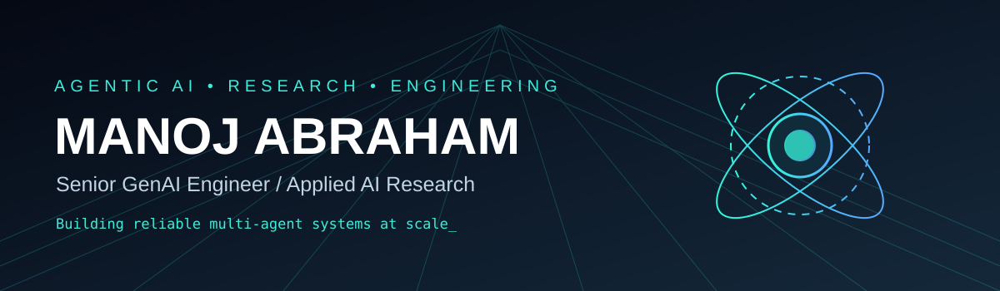

  

## ◈ Executive Profile
Senior GenAI Engineer with **4+ years** across AI, machine learning, Python engineering and data platforms. I build tool-augmented agent systems, multi-tenant autonomous execution environments, stateful conversational AI, production ML pipelines and healthcare revenue-cycle automation. My work combines applied LLM research, platform architecture, agent observability, secure workflow controls and measurable delivery outcomes.

## ◈ Engineering Impact

| 27% ↓ | 10M+ | 2M+ | 50% ↑ |
|:--:|:--:|:--:|:--:|
| LLM inference latency | Knowledge graph nodes; reported sub-100ms retrieval | Daily telemetry events | Faster retail data collection |

| 40% ↑ | 30% ↓ | 20% ↓ | 12+ |
|:--:|:--:|:--:|:--:|
| Analytics refresh speed | Security issue MTTR | Manual QA effort | BI dashboards |

## ◈ Featured Engineering — Animated Showcase

### Healthcare AI & Enterprise Automation · Calpion Software Technologies
- **Zocdoc Benefits Verification:** Salesforce intake → AdvancedMD chart retrieval → payer mapping → pVerify eligibility → network checks → eight-row deterministic decision table → benefits note and case response preparation. Designed shadow-mode review, six write gates, kill switch, daily limits, completeness checks and post-write read-back verification.
- **MF28 Payment Posting (in development):** Python-driven remittance ingestion, reconciliation, posting-rule validation, exception queues and transaction-level auditability.
- **PMAB Intelligence (in development):** X12 835 / ERA analytics for denial root causes, recurring payer issues, payment lag, underpayments, authorization denials and coding trends.
- **AI Voice Calling (in development):** Healthcare conversational automation, call-state management, structured outcomes and enterprise handoffs; integrations depend on the project.

### Autonomous Agents · BaseThesis Labs
- **Synth:** Multi-tenant agent platform with Docker isolation, network segmentation, resource quotas, ephemeral sandbox lifecycles and MCP tool access across files, databases, REST APIs and browser automation.
- Built layered global/project/session memory, Redis pub/sub coordination, cron/event-driven execution, JSONL traces and React/TypeScript operations console with SQLite FTS5 search, token/cost monitoring and Anthropic-powered administration.

### Conversational Intelligence · PEDASYS
- **Zavmo.ai:** Led a five-person AI team building multi-turn conversational intelligence with intent classification, NER and dialogue-state tracking.
- Built BERT, GPT-NeoX, Falcon, FastText, BiLSTM-CRF and spaCy NER pipelines; PyTorch domain tuning, FastAPI serving, Neo4j/RedisGraph retrieval and AWS deployments with evaluation gates, shadow tests and blue/green releases.

## ◈ Professional Journey
| Period | Role | Organization | Highlights |
|---|---|---|---|
| Jul 2026 – Present | **Senior GenAI Engineer** | Calpion Software Technologies · Bengaluru | Zocdoc, MF28, PMAB, voice automation; safety-gated healthcare workflows |
| Jan – Apr 2026 | **AI Research Scientist (Consultant)** | BaseThesis Labs · Bengaluru | Synth autonomous agent platform, MCP, persistent memory, sandboxed execution |
| Apr – Dec 2025 | **Lead Data Scientist** | PEDASYS · Bengaluru | Led 5-person team; Zavmo.ai; 27% inference latency reduction |
| Dec 2023 – Dec 2024 | **Data Analyst** | Hexnode · Bengaluru | 12+ dashboards, 2M+ daily events, 40% refresh improvement, SQL from 8 min to under 60 sec |
| Apr – Nov 2023 | **Data Analyst** | NielsenIQ · Chennai | 230+ e-commerce platforms, 50% faster acquisition, AWS pipelines, 15+ market taxonomies |
| Aug 2022 – Mar 2023 | **Python Developer** | Concentrix · Chennai | Endpoint security automation, 30% lower MTTR, 20% less manual QA |

## ◈ Technical Arsenal
| Area | Tools and techniques |
|---|---|
| **Agent orchestration** | LangGraph, LangChain, stateful graphs, supervisor-worker patterns, conditional routing, MCP, function/tool calling, scheduling |
| **LLM systems** | OpenAI, Anthropic, GPT-NeoX, Falcon, Ollama, Groq, prompt/context engineering, structured output, transformer tuning |
| **Reliability & evaluations** | Human-in-the-loop, tool permissions, deterministic fallbacks, audit trails, observability, shadow deployment, A/B testing |
| **Retrieval & memory** | RAG, embeddings, FAISS, Neo4j, RedisGraph, semantic search, persistent context, knowledge graphs, SQLite FTS5 |
| **ML research** | PyTorch, TensorFlow, Hugging Face, scikit-learn, NLP, NER, RL, temporal models, quantization, inference optimization |
| **Languages** | Python, SQL, TypeScript, JavaScript, Bash, Solidity |
| **Services** | FastAPI, Django REST, Node.js, Redis, Celery, Airflow |
| **Cloud & delivery** | AWS EC2, S3, Lambda, SageMaker, Glue, Athena, Step Functions; Azure, Docker, Kubernetes, GitHub Actions, CI/CD, MLflow |
| **Data systems** | PostgreSQL, DynamoDB, MongoDB, SQLite, Pandas, PySpark, ETL, Power BI, Plotly |

## ◈ Selected Applied Research
> The following are research initiatives or concepts, not claims of production deployment.

- **BitForge · 1-bit Edge LLMs:** Exploring BitNet b1.58 for low-power inference on orbital, embedded and air-gapped devices; CUDA/C++ kernels, ONNX conversion, ARM targets and bandwidth-aware quantization.
- **CellSense AI · Battery Intelligence:** Investigating Li-ion/LFP state-of-health, state-of-charge and remaining useful life with LSTM, Temporal Fusion Transformers, telemetry and physics-informed impedance modeling.
- **MediatorAI · Clinical Multi-Agent Decision Support:** Proposed multilingual intake, diagnostic support, referrals and follow-up for community-health workflows using offline quantized models and FHIR-aligned data.
- **RiskPulse / FaultLine · Financial Risk AI:** Research into causal GNNs, structural VAR, Granger causality and temporal contagion across sovereign debt and interbank exposures.
- **ORBITEX · Orbital Autonomy:** Conceptual radar/LiDAR sensor fusion, RL-based debris-avoidance planning and decentralized orbital asset registry.

## ◈ Deep Engineering Principles
**Agent architecture:** Multi-step state transitions, scoped tool contracts, state persistence, escalation, replay and recovery checkpoints.

**Distributed execution:** Containerized workloads, Redis queues, async services, API gateways, idempotency, retries, circuit breakers and scheduling.

**Evaluation & governance:** Evidence-linked outputs, deterministic decision tables, human approval for consequential writes, trace inspection, regression checks and rollback readiness.

**Performance engineering:** Inference optimization, query tuning, data ingestion throughput, observability, latency and cost monitoring.

## ◈ Domain Expertise
Healthcare RCM and clinical decision support · Enterprise conversational AI · Edge/low-power inference · Battery intelligence · Macro-financial graph learning · Orbital autonomy and sensor-driven optimization.

## ◈ Education
**B.Tech — Information Technology** · Meenakshi Sundararajan Engineering College, Chennai · **2018–2022** · **CGPA 8.4/10**

## ◈ GitHub Activity

 

---

<b>ENGINEER THE INTELLIGENCE. DESIGN THE GUARDRAILS. SHIP THE SYSTEM.</b> Manoj Abraham · Bengaluru, India · chrismanoj62@gmail.com

