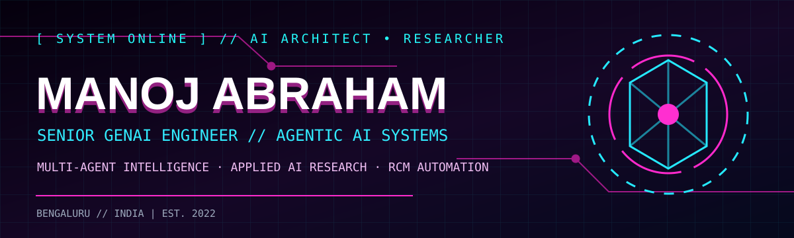

<div align="center">

<br/><br/>

<br/>
<a href="mailto:chrismanoj62@gmail.com"></a>
<a href="https://github.com/Manoj-619"></a>

</div>

<div align="center"></div>


<div align="center">


</div>

**MANOJ ABRAHAM** — Senior GenAI Engineer · Agentic AI Systems · Applied AI Research.

4+ years across AI, machine learning, Python engineering and data platforms. I build **tool-augmented autonomous agents, multi-tenant execution environments, stateful conversational AI, production ML pipelines and healthcare revenue-cycle automation**, combining applied LLM research, secure architecture, observability, and operational reliability.

```yaml
operator: Manoj Abraham
role: Senior GenAI Engineer
location: Bengaluru, India
focus: [Agentic AI, Multi-Agent Systems, LLM Infrastructure, Applied AI Research]
engineering: [Secure Tool Execution, Human-in-the-Loop, Observability, Cloud-Native ML]
status: BUILDING
```

## `02 // LIVE SIGNALS`
| ⚡ 27% lower | 🧠 10M+ nodes | 📡 2M+ / day | 🚀 50% faster |
|:--:|:--:|:--:|:--:|
| LLM inference latency | Knowledge graph; reported sub-100ms retrieval | Telemetry events processed | Retail data acquisition |
| **40% faster** | **30% lower** | **20% lower** | **12+ dashboards** |
| Analytics refresh | Security issue MTTR | Manual QA effort | BI delivery |

<div align="center"></div>


<div align="center"></div>


| Project | Scope / technologies | Stage |
|---|---|---|
| **Synth** | Multi-tenant autonomous agents, Docker sandbox isolation, quotas, network segmentation, MCP tools, persistent global/project/session memory, Redis pub/sub, cron/event execution, JSONL traces, SQLite FTS5, React/TypeScript operations console, token/cost monitoring | Engineered platform |
| **Zavmo.ai** | Enterprise multi-turn conversational AI, intent recognition, entity extraction, dialogue-state tracking, BERT, GPT-NeoX, Falcon, FastText, BiLSTM-CRF, spaCy, PyTorch tuning, Neo4j/RedisGraph, FastAPI | Engineered platform |
| **Zocdoc Benefits Verification** | Salesforce → AdvancedMD → payer mapping → pVerify → network-reference checks → eight-row deterministic decision logic → benefits note/case response; shadow mode, six write gates, kill switch, read-back verification | Engineering initiative |
| **MF28 Payment Posting** | Python remittance ingestion, reconciliation, posting-rule validation, exception queues, transaction-level traceability | In development |
| **PMAB Remittance Intelligence** | X12 835 / ERA denial causes, payer recurrence, payment lag, underpayments, authorization denials, coding trends | In development |
| **AI Voice Calling** | Healthcare conversational workflows, call-state management, outcome capture, enterprise handoffs | In development; integrations project-dependent |


| Research project | Research direction |
|---|---|
| **BitForge · 1-bit Edge LLMs** | BitNet b1.58, CUDA/C++, ONNX, ARM and bandwidth-constrained inference for embedded, orbital and air-gapped targets |
| **CellSense AI · Battery Intelligence** | Li-ion/LFP SoH, SoC, remaining useful life, LSTM, Temporal Fusion Transformers, telemetry and physics-informed impedance modeling |
| **MediatorAI · Clinical Multi-Agent Support** | Proposed multilingual intake, diagnostic support, referral and follow-up agents, offline quantized models, FHIR-aligned data |
| **RiskPulse / FaultLine · Financial Risk AI** | Causal GNNs, structural VAR, Granger causality, temporal contagion, sovereign debt and interbank exposure |
| **ORBITEX · Orbital Autonomy** | Conceptual radar/LiDAR fusion, RL-based debris avoidance and decentralized orbital asset registry |

*Research projects are exploratory or conceptual, not represented as production deployments.*


Every public repository currently visible under this GitHub account is linked below. Names are retained exactly as published; a repository link alone does not imply production readiness.

| Repository | Access |
|---|---|
| [`MI-protocols`](https://github.com/Manoj-619/MI-protocols) | Public repository · [Explore source](https://github.com/Manoj-619/MI-protocols) |
| [`MI`](https://github.com/Manoj-619/MI) | Public repository · [Explore source](https://github.com/Manoj-619/MI) |
| [`MANOJ`](https://github.com/Manoj-619/MANOJ) | Public repository · [Explore source](https://github.com/Manoj-619/MANOJ) |
| [`Cosmo`](https://github.com/Manoj-619/Cosmo) | Public repository · [Explore source](https://github.com/Manoj-619/Cosmo) |
| [`Xapi`](https://github.com/Manoj-619/Xapi) | Public repository · [Explore source](https://github.com/Manoj-619/Xapi) |
| [`xapii`](https://github.com/Manoj-619/xapii) | Public repository · [Explore source](https://github.com/Manoj-619/xapii) |
| [`Rishitha`](https://github.com/Manoj-619/Rishitha) | Public repository · [Explore source](https://github.com/Manoj-619/Rishitha) |
| [`cartoo-new`](https://github.com/Manoj-619/cartoo-new) | Public repository · [Explore source](https://github.com/Manoj-619/cartoo-new) |
| [`piaxis`](https://github.com/Manoj-619/piaxis) | Public repository · [Explore source](https://github.com/Manoj-619/piaxis) |
| [`Trading`](https://github.com/Manoj-619/Trading) | Public repository · [Explore source](https://github.com/Manoj-619/Trading) |
| [`voice-agent-sarthak`](https://github.com/Manoj-619/voice-agent-sarthak) | Public repository · [Explore source](https://github.com/Manoj-619/voice-agent-sarthak) |
| [`Manoj-Abraham`](https://github.com/Manoj-619/Manoj-Abraham) | Public repository · [Explore source](https://github.com/Manoj-619/Manoj-Abraham) |
| [`incident-zero`](https://github.com/Manoj-619/incident-zero) | Public repository · [Explore source](https://github.com/Manoj-619/incident-zero) |
| [`Orbit---Sentinal`](https://github.com/Manoj-619/Orbit---Sentinal) | Public repository · [Explore source](https://github.com/Manoj-619/Orbit---Sentinal) |

> Private repositories are deliberately excluded from this public index. Work already described in the resume is included above without exposing private source locations.

## `04 // EXPERIENCE LOG`
| Timeline | Position | Organization | Mission |
|---|---|---|---|
| Jul 2026 – Present | **Senior GenAI Engineer** | Calpion Software Technologies · Bengaluru | Healthcare AI: Zocdoc, MF28, PMAB, AI voice calling; secure Python automation |
| Jan – Apr 2026 | **AI Research Scientist (Consultant)** | BaseThesis Labs · Bengaluru | Synth platform, MCP integrations, memory, sandboxes, operations console |
| Apr – Dec 2025 | **Lead Data Scientist** | PEDASYS · Bengaluru | Led five-person AI team, Zavmo.ai, inference tuning, graph retrieval |
| Dec 2023 – Dec 2024 | **Data Analyst** | Hexnode · Bengaluru | 12+ Power BI dashboards, 2M+ daily telemetry events, Django/Celery ETL, SQL optimization from 8 min to <60 sec |
| Apr – Nov 2023 | **Data Analyst** | NielsenIQ · Chennai | 230+ e-commerce sources, asyncio/Scrapy/Selenium, AWS Lambda, Step Functions, Glue/PySpark, 15+ market taxonomies |
| Aug 2022 – Mar 2023 | **Python Developer** | Concentrix · Chennai | Symantec endpoint automation, patching, vulnerability scanning, log parsing, diagnostics, CI regression scripts |

## `05 // CYBERDECK: TECH STACK`
| Module | Arsenal |
|---|---|
| **Agent Orchestration** | LangGraph, LangChain, stateful graphs, conditional routing, supervisor-worker, MCP, tool/function calling, task scheduling |
| **LLM Systems** | OpenAI / Anthropic APIs, GPT-NeoX, Falcon, Ollama, Groq, prompt/context engineering, structured outputs, transformer tuning |
| **Reliability & Evals** | Human-in-the-loop, permissions, deterministic fallbacks, agent traces, observability, A/B testing, shadow deployment |
| **Retrieval & Memory** | RAG, FAISS, embeddings, semantic search, Neo4j, RedisGraph, knowledge graphs, persistent memory, SQLite FTS5 |
| **ML Research** | PyTorch, TensorFlow, Hugging Face, scikit-learn, spaCy, FastText, BERT, NER, RL, temporal modeling, quantization |
| **Languages** | Python, SQL, TypeScript, JavaScript, Bash, Solidity |
| **Services & Distributed** | FastAPI, Django REST, Node.js, Redis, Celery, Airflow, asyncio, queues, idempotency, retries, circuit breakers |
| **Cloud & DevOps** | AWS EC2, S3, Lambda, SageMaker, Glue, Athena, Step Functions; Azure, Docker, Kubernetes, GitHub Actions, CI/CD, MLflow |
| **Data & Analytics** | PostgreSQL, DynamoDB, MongoDB, SQLite, Pandas, PySpark, ETL, Power BI, Plotly |

## `06 // SYSTEM DESIGN DOCTRINE`
- **Agent architecture:** Explicit tool schemas, permission boundaries, multi-step state transitions, checkpoints, escalation and replay.
- **LLM applications:** Domain adaptation, prompt templates, structured extraction, retrieval augmentation, dialogue-state propagation, token economics and latency tuning.
- **Distributed execution:** Sandboxed containers, asynchronous services, Redis event queues, API gateways, idempotency, retries and scheduling.
- **Governance:** Evidence-linked outputs, deterministic decision tables, human approval for consequential writes, validation gates, traceability and rollback readiness.
- **ML/Data operations:** Experiment tracking, model benchmarks, regression checks, SageMaker workflows, cloud-native ETL and release automation.
- **Domain systems:** HIPAA X12 835/ERA, healthcare RCM, eligibility, benefits, provider network checks, Salesforce, AdvancedMD, pVerify, CentralReach.

## `07 // ACADEMIC RECORD`
**B.Tech · Information Technology** — Meenakshi Sundararajan Engineering College, Chennai · **2018–2022** · **CGPA 8.4 / 10**

## `08 // GITHUB TELEMETRY`
<div align="center">


<br/>

</div>

---
<div align="center">
<code>NEURAL SYSTEMS ONLINE // INTELLIGENCE WITH GUARDRAILS // BUILD THE FUTURE</code><br/><br/>
<b>MANOJ ABRAHAM</b> · Bengaluru, India · <a href="mailto:chrismanoj62@gmail.com">chrismanoj62@gmail.com</a>
</div>
