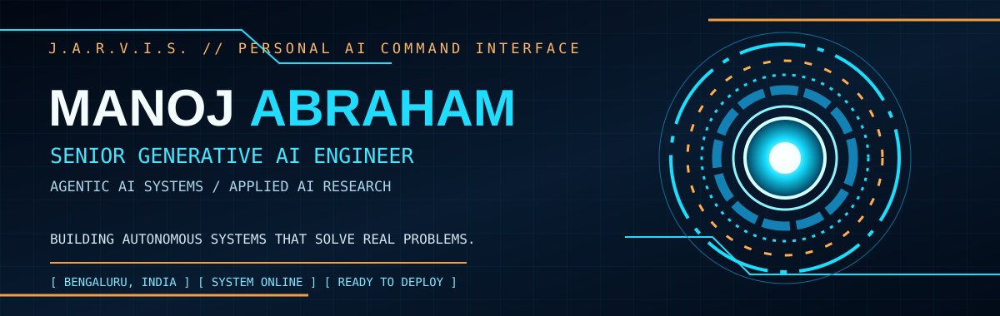
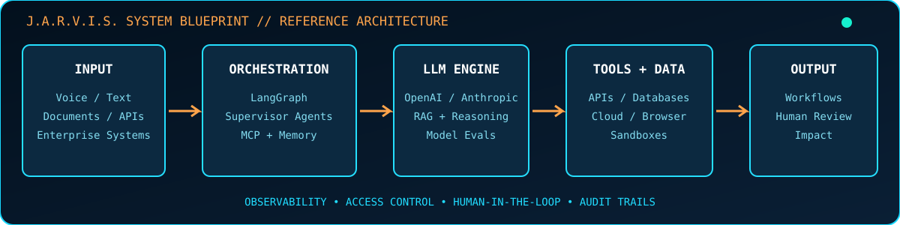

<div align="center">

<br/><br/>

<br/>
<a href="mailto:chrismanoj62@gmail.com"></a>
<a href="https://github.com/Manoj-619"></a>

</div>


<div align="center">


</div>

**MANOJ ABRAHAM** — Senior GenAI Engineer · Agentic AI Systems · Applied AI Research.

4+ years across AI, machine learning, Python engineering and data platforms. I build **tool-augmented autonomous agents, multi-tenant execution environments, stateful conversational AI, production ML pipelines and healthcare revenue-cycle automation**, combining applied LLM research, secure architecture, observability, and operational reliability.

```yaml
operator: Manoj Abraham
role: Senior GenAI Engineer
location: Bengaluru, India
focus: [Agentic AI, Multi-Agent Systems, LLM Infrastructure, Applied AI Research]
engineering: [Secure Tool Execution, Human-in-the-Loop, Observability, Cloud-Native ML]
status: BUILDING
```


<table>
<thead><tr><th align="left">⚡ 27% lower</th><th align="left">🧠 10M+ nodes</th><th align="left">📡 2M+ / day</th><th align="left">🚀 50% faster</th></tr></thead>
<tbody>
<tr><td>LLM inference latency</td><td>Knowledge graph; reported sub-100ms retrieval</td><td>Telemetry events processed</td><td>Retail data acquisition</td></tr>
<tr><td><strong>40% faster</strong></td><td><strong>30% lower</strong></td><td><strong>20% lower</strong></td><td><strong>12+ dashboards</strong></td></tr>
<tr><td>Analytics refresh</td><td>Security issue MTTR</td><td>Manual QA effort</td><td>BI delivery</td></tr>
</tbody>
</table>


<div align="center"></div>


<table>
<thead><tr><th align="left">Project</th><th align="left">Scope / technologies</th><th align="left">Stage</th></tr></thead>
<tbody>
<tr><td><strong>Synth</strong></td><td>Multi-tenant autonomous agents, Docker sandbox isolation, quotas, network segmentation, MCP tools, persistent global/project/session memory, Redis pub/sub, cron/event execution, JSONL traces, SQLite FTS5, React/TypeScript operations console, token/cost monitoring</td><td>Engineered platform</td></tr>
<tr><td><strong>Zavmo.ai</strong></td><td>Enterprise multi-turn conversational AI, intent recognition, entity extraction, dialogue-state tracking, BERT, GPT-NeoX, Falcon, FastText, BiLSTM-CRF, spaCy, PyTorch tuning, Neo4j/RedisGraph, FastAPI</td><td>Engineered platform</td></tr>
<tr><td><strong>Zocdoc Benefits Verification</strong></td><td>Salesforce → AdvancedMD → payer mapping → pVerify → network-reference checks → eight-row deterministic decision logic → benefits note/case response; shadow mode, six write gates, kill switch, read-back verification</td><td>Engineering initiative</td></tr>
<tr><td><strong>MF28 Payment Posting</strong></td><td>Python remittance ingestion, reconciliation, posting-rule validation, exception queues, transaction-level traceability</td><td>In development</td></tr>
<tr><td><strong>PMAB Remittance Intelligence</strong></td><td>X12 835 / ERA denial causes, payer recurrence, payment lag, underpayments, authorization denials, coding trends</td><td>In development</td></tr>
<tr><td><strong>AI Voice Calling</strong></td><td>Healthcare conversational workflows, call-state management, outcome capture, enterprise handoffs</td><td>In development; integrations project-dependent</td></tr>
</tbody>
</table>


<table>
<thead><tr><th align="left">Research project</th><th align="left">Research direction</th></tr></thead>
<tbody>
<tr><td><strong>BitForge · 1-bit Edge LLMs</strong></td><td>BitNet b1.58, CUDA/C++, ONNX, ARM and bandwidth-constrained inference for embedded, orbital and air-gapped targets</td></tr>
<tr><td><strong>CellSense AI · Battery Intelligence</strong></td><td>Li-ion/LFP SoH, SoC, remaining useful life, LSTM, Temporal Fusion Transformers, telemetry and physics-informed impedance modeling</td></tr>
<tr><td><strong>MediatorAI · Clinical Multi-Agent Support</strong></td><td>Proposed multilingual intake, diagnostic support, referral and follow-up agents, offline quantized models, FHIR-aligned data</td></tr>
<tr><td><strong>RiskPulse / FaultLine · Financial Risk AI</strong></td><td>Causal GNNs, structural VAR, Granger causality, temporal contagion, sovereign debt and interbank exposure</td></tr>
<tr><td><strong>ORBITEX · Orbital Autonomy</strong></td><td>Conceptual radar/LiDAR fusion, RL-based debris avoidance and decentralized orbital asset registry</td></tr>
</tbody>
</table>


*Research projects are exploratory or conceptual, not represented as production deployments.*


Every public repository currently visible under this GitHub account is linked below. Names are retained exactly as published; a repository link alone does not imply production readiness.


<table>
<thead><tr><th align="left">Repository</th><th align="left">Access</th></tr></thead>
<tbody>
<tr><td><a href="https://github.com/Manoj-619/MI-protocols"><code>MI-protocols</code></a></td><td>Public repository · <a href="https://github.com/Manoj-619/MI-protocols">Explore source</a></td></tr>
<tr><td><a href="https://github.com/Manoj-619/MI"><code>MI</code></a></td><td>Public repository · <a href="https://github.com/Manoj-619/MI">Explore source</a></td></tr>
<tr><td><a href="https://github.com/Manoj-619/MANOJ"><code>MANOJ</code></a></td><td>Public repository · <a href="https://github.com/Manoj-619/MANOJ">Explore source</a></td></tr>
<tr><td><a href="https://github.com/Manoj-619/Cosmo"><code>Cosmo</code></a></td><td>Public repository · <a href="https://github.com/Manoj-619/Cosmo">Explore source</a></td></tr>
<tr><td><a href="https://github.com/Manoj-619/Xapi"><code>Xapi</code></a></td><td>Public repository · <a href="https://github.com/Manoj-619/Xapi">Explore source</a></td></tr>
<tr><td><a href="https://github.com/Manoj-619/xapii"><code>xapii</code></a></td><td>Public repository · <a href="https://github.com/Manoj-619/xapii">Explore source</a></td></tr>
<tr><td><a href="https://github.com/Manoj-619/Rishitha"><code>Rishitha</code></a></td><td>Public repository · <a href="https://github.com/Manoj-619/Rishitha">Explore source</a></td></tr>
<tr><td><a href="https://github.com/Manoj-619/cartoo-new"><code>cartoo-new</code></a></td><td>Public repository · <a href="https://github.com/Manoj-619/cartoo-new">Explore source</a></td></tr>
<tr><td><a href="https://github.com/Manoj-619/piaxis"><code>piaxis</code></a></td><td>Public repository · <a href="https://github.com/Manoj-619/piaxis">Explore source</a></td></tr>
<tr><td><a href="https://github.com/Manoj-619/Trading"><code>Trading</code></a></td><td>Public repository · <a href="https://github.com/Manoj-619/Trading">Explore source</a></td></tr>
<tr><td><a href="https://github.com/Manoj-619/voice-agent-sarthak"><code>voice-agent-sarthak</code></a></td><td>Public repository · <a href="https://github.com/Manoj-619/voice-agent-sarthak">Explore source</a></td></tr>
<tr><td><a href="https://github.com/Manoj-619/Manoj-Abraham"><code>Manoj-Abraham</code></a></td><td>Public repository · <a href="https://github.com/Manoj-619/Manoj-Abraham">Explore source</a></td></tr>
<tr><td><a href="https://github.com/Manoj-619/incident-zero"><code>incident-zero</code></a></td><td>Public repository · <a href="https://github.com/Manoj-619/incident-zero">Explore source</a></td></tr>
<tr><td><a href="https://github.com/Manoj-619/Orbit---Sentinal"><code>Orbit---Sentinal</code></a></td><td>Public repository · <a href="https://github.com/Manoj-619/Orbit---Sentinal">Explore source</a></td></tr>
</tbody>
</table>


> Private repositories are deliberately excluded from this public index. Work already described in the resume is included above without exposing private source locations.


<table>
<thead><tr><th align="left">Timeline</th><th align="left">Position</th><th align="left">Organization</th><th align="left">Mission</th></tr></thead>
<tbody>
<tr><td>Jul 2026 – Present</td><td><strong>Senior GenAI Engineer</strong></td><td>Calpion Software Technologies · Bengaluru</td><td>Healthcare AI: Zocdoc, MF28, PMAB, AI voice calling; secure Python automation</td></tr>
<tr><td>Jan – Apr 2026</td><td><strong>AI Research Scientist (Consultant)</strong></td><td>BaseThesis Labs · Bengaluru</td><td>Synth platform, MCP integrations, memory, sandboxes, operations console</td></tr>
<tr><td>Apr – Dec 2025</td><td><strong>Lead Data Scientist</strong></td><td>PEDASYS · Bengaluru</td><td>Led five-person AI team, Zavmo.ai, inference tuning, graph retrieval</td></tr>
<tr><td>Dec 2023 – Dec 2024</td><td><strong>Data Analyst</strong></td><td>Hexnode · Bengaluru</td><td>12+ Power BI dashboards, 2M+ daily telemetry events, Django/Celery ETL, SQL optimization from 8 min to <60 sec</td></tr>
<tr><td>Apr – Nov 2023</td><td><strong>Data Analyst</strong></td><td>NielsenIQ · Chennai</td><td>230+ e-commerce sources, asyncio/Scrapy/Selenium, AWS Lambda, Step Functions, Glue/PySpark, 15+ market taxonomies</td></tr>
<tr><td>Aug 2022 – Mar 2023</td><td><strong>Python Developer</strong></td><td>Concentrix · Chennai</td><td>Symantec endpoint automation, patching, vulnerability scanning, log parsing, diagnostics, CI regression scripts</td></tr>
</tbody>
</table>


<table>
<thead><tr><th align="left">Module</th><th align="left">Arsenal</th></tr></thead>
<tbody>
<tr><td><strong>Agent Orchestration</strong></td><td>LangGraph, LangChain, stateful graphs, conditional routing, supervisor-worker, MCP, tool/function calling, task scheduling</td></tr>
<tr><td><strong>LLM Systems</strong></td><td>OpenAI / Anthropic APIs, GPT-NeoX, Falcon, Ollama, Groq, prompt/context engineering, structured outputs, transformer tuning</td></tr>
<tr><td><strong>Reliability & Evals</strong></td><td>Human-in-the-loop, permissions, deterministic fallbacks, agent traces, observability, A/B testing, shadow deployment</td></tr>
<tr><td><strong>Retrieval & Memory</strong></td><td>RAG, FAISS, embeddings, semantic search, Neo4j, RedisGraph, knowledge graphs, persistent memory, SQLite FTS5</td></tr>
<tr><td><strong>ML Research</strong></td><td>PyTorch, TensorFlow, Hugging Face, scikit-learn, spaCy, FastText, BERT, NER, RL, temporal modeling, quantization</td></tr>
<tr><td><strong>Languages</strong></td><td>Python, SQL, TypeScript, JavaScript, Bash, Solidity</td></tr>
<tr><td><strong>Services & Distributed</strong></td><td>FastAPI, Django REST, Node.js, Redis, Celery, Airflow, asyncio, queues, idempotency, retries, circuit breakers</td></tr>
<tr><td><strong>Cloud & DevOps</strong></td><td>AWS EC2, S3, Lambda, SageMaker, Glue, Athena, Step Functions; Azure, Docker, Kubernetes, GitHub Actions, CI/CD, MLflow</td></tr>
<tr><td><strong>Data & Analytics</strong></td><td>PostgreSQL, DynamoDB, MongoDB, SQLite, Pandas, PySpark, ETL, Power BI, Plotly</td></tr>
</tbody>
</table>


- **Agent architecture:** Explicit tool schemas, permission boundaries, multi-step state transitions, checkpoints, escalation and replay.
- **LLM applications:** Domain adaptation, prompt templates, structured extraction, retrieval augmentation, dialogue-state propagation, token economics and latency tuning.
- **Distributed execution:** Sandboxed containers, asynchronous services, Redis event queues, API gateways, idempotency, retries and scheduling.
- **Governance:** Evidence-linked outputs, deterministic decision tables, human approval for consequential writes, validation gates, traceability and rollback readiness.
- **ML/Data operations:** Experiment tracking, model benchmarks, regression checks, SageMaker workflows, cloud-native ETL and release automation.
- **Domain systems:** HIPAA X12 835/ERA, healthcare RCM, eligibility, benefits, provider network checks, Salesforce, AdvancedMD, pVerify, CentralReach.


**B.Tech · Information Technology** — Meenakshi Sundararajan Engineering College, Chennai · **2018–2022** · **CGPA 8.4 / 10**


<div align="center">


<br/>

</div>

---
<div align="center">
<code>J.A.R.V.I.S. ONLINE // AUTONOMOUS INTELLIGENCE // ENGINEERED WITH GUARDRAILS</code><br/><br/>
<b>MANOJ ABRAHAM</b> · Bengaluru, India · <a href="mailto:chrismanoj62@gmail.com">chrismanoj62@gmail.com</a>
</div>
